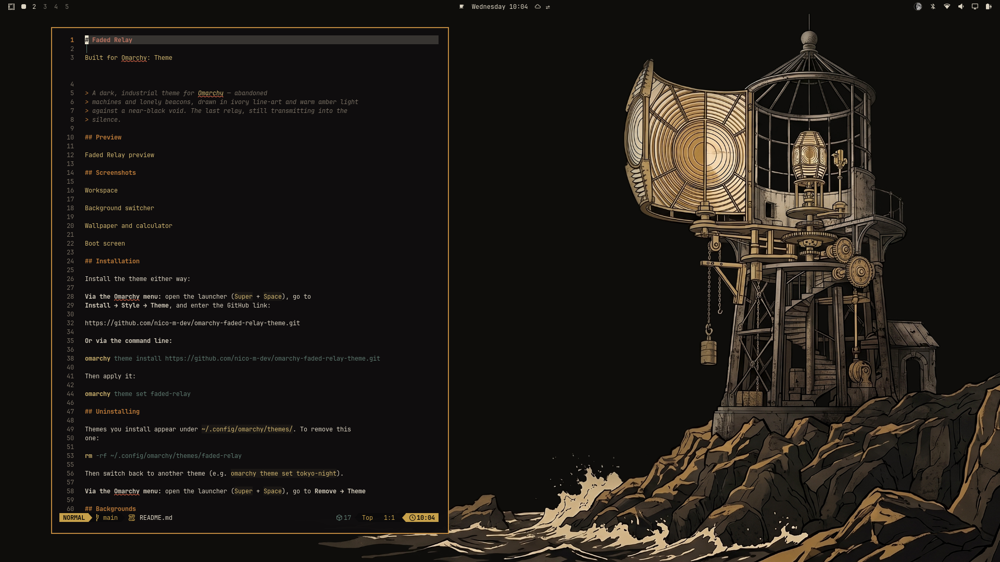
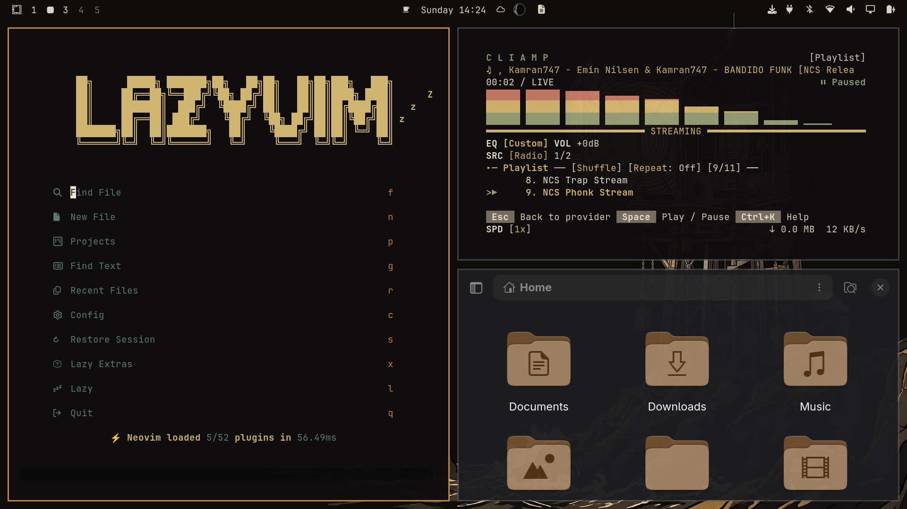
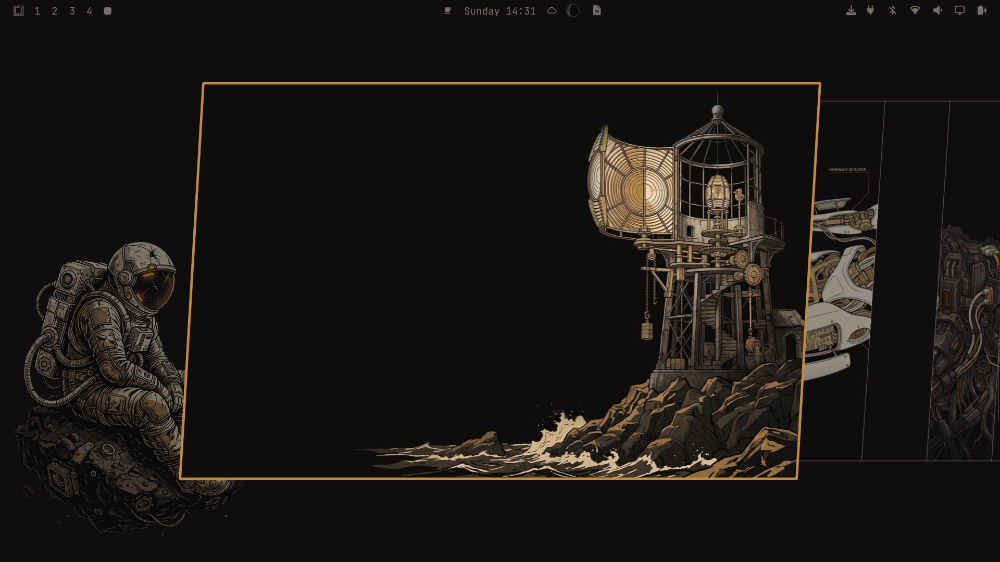
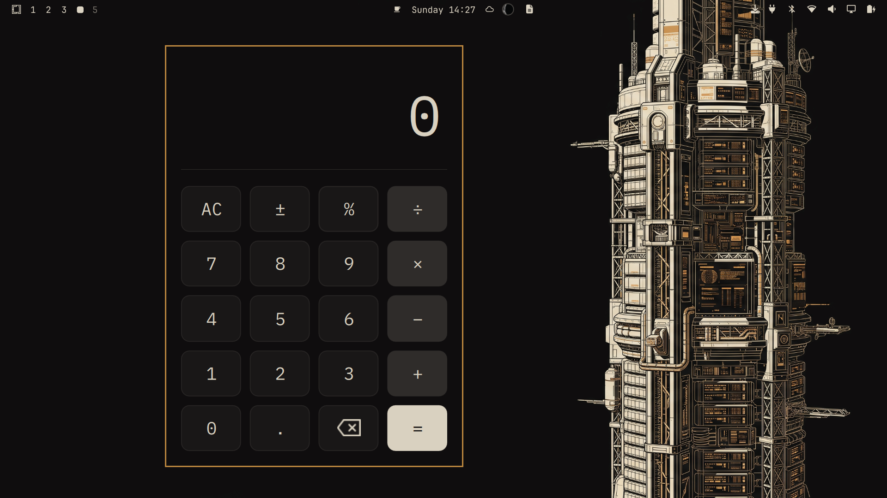
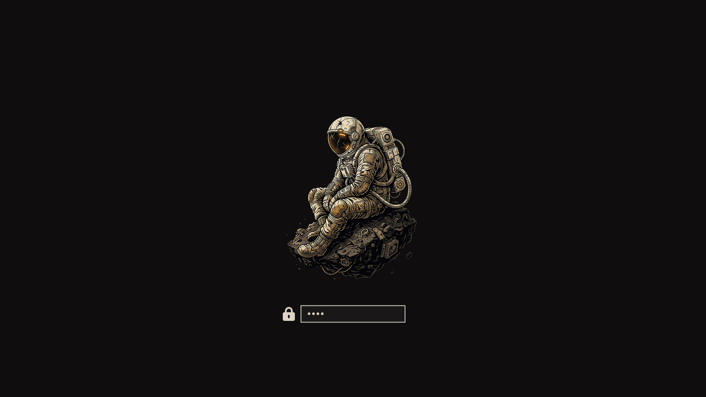

# Faded Relay

[](https://github.com/tcballard/omarchy-badges)

> A dark, industrial theme for [Omarchy](https://omarchy.org/) — abandoned
> machines and lonely beacons, drawn in ivory line-art and warm amber light
> against a near-black void. The last relay, still transmitting into the
> silence.

## Preview



## Screenshots









## Installation

Install the theme either way:

**Via the Omarchy menu:** open the launcher (`Super` + `Space`), go to
**Install → Style → Theme**, and enter the GitHub link:

```
https://github.com/nico-m-dev/omarchy-faded-relay-theme.git
```

**Or via the command line:**

```bash
omarchy theme install https://github.com/nico-m-dev/omarchy-faded-relay-theme.git
```

Then apply it:

```bash
omarchy theme set faded-relay
```

## Uninstalling

Themes you install appear under `~/.config/omarchy/themes/`. To remove this
one:

```bash
rm -rf ~/.config/omarchy/themes/faded-relay
```

Then switch back to another theme (e.g. `omarchy theme set tokyo-night`).

**Via the Omarchy menu:** open the launcher (`Super` + `Space`), go to **Remove → Theme**

## Backgrounds

Thirteen original ultrawide (21:9) wallpapers, all in the same ivory-and-amber
industrial style on a warm near-black void — composed so the same artwork also
looks great on 16:9 screens:

| File                    | Subject                                         |
| ----------------------- | ----------------------------------------------- |
| `01-lighthouse.jpg`     | Abandoned lighthouse with exposed Fresnel lens   |
| `02-android.jpg`        | Half-disassembled android, mechanisms exposed    |
| `03-spaceman.jpg`       | Lonely astronaut on a small asteroid             |
| `04-biomechtree.jpg`    | Biomechanical tree stump with metal roots        |
| `05-turbine.jpg`        | Cutaway view of an open turbine engine           |
| `06-spacestation4.jpg`  | Data-archive tower, glowing amber panels         |
| `07-spacestation3.jpg`  | Data-archive tower, soft window glow             |
| `08-spacestation2.jpg`  | Data-archive tower, sharp technical linework     |
| `09-spacestation1.jpg`  | Data-archive tower, subtle matte shading         |
| `10-containercrane.jpg` | Massive harbor crane against the void            |
| `11-spacearm.jpg`       | Heavy industrial docking arm in deep space       |
| `12-excavator.jpg`      | Mining excavator half-buried in an empty plain   |
| `13-rov.jpg`            | Deep-sea ROV resting on the ocean floor          |

## Color palette

A dark, high-contrast palette — warm amber and ivory on a near-black void,
with muted hue hints for the semantic colors.

| Role  | Color    | Swatch                              |
| ----- | -------- | ----------------------------------- |
| Accent| `#C08A3E`|  |
| Text  | `#DCD4C3`|  |
| Bg    | `#0F0D0E`|  |
| Red   | `#C05E45`|  |
| Green | `#7C8354`|  |
| Cyan  | `#649582`|  |
| Blue  | `#7F97A6`|  |
| Magenta | `#A0799B`|  |

## License

[MIT](LICENSE)